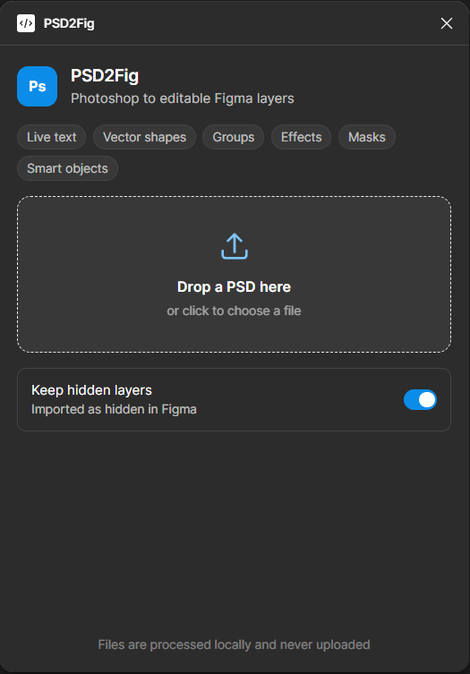

# PSD2Fig

PSD2Fig is a Figma plugin that imports a Photoshop `.psd` file as **editable layers**, not a flat picture. Drop a file in the plugin window and it builds a new frame next to your existing content.



Built with TypeScript, esbuild and [ag-psd](https://github.com/Agamnentzar/ag-psd). The PSD is parsed locally in the plugin window, and nothing is uploaded.

## Features

- Keeps live text, vector shapes, groups, effects and masks editable.
- Converts smart objects into native Figma shapes.
- Optionally keeps hidden layers, imported as hidden.
- Shows a progress bar while importing, with a **Cancel** button.
- Ends with a report of layer counts and a list of anything that could not be converted.
- Runs offline. The manifest blocks all network access.

## Installation

The plugin is loaded as a development plugin from this repository. The compiled `dist/` folder is not committed, so build it first.

1. Run `npm install` and `npm run build` inside `PSD2Fig`.
2. Open the Figma desktop app.
3. Go to **Plugins > Development > Import plugin from manifest**.
4. Select `PSD2Fig/manifest.json`.
5. Run it from **Plugins > Development > PSD2Fig**.

## Usage

1. Drop a `.psd` file onto the drop zone, or click it to choose a file.
2. Turn **Keep hidden layers** on or off. When on, hidden layers are imported and hidden in Figma.
3. Wait for the import to finish. Click **Cancel** to stop it.
4. A new frame is created next to your existing content. The report shows how many layers, text layers, shapes, smart objects and images were created, followed by any warnings.

## What each PSD layer becomes

| PSD | Figma |
| --- | --- |
| Group | Group (nested groups keep their structure) |
| Text layer | Live text node: font, size, colour, tracking, line height, alignment, underline/strike, caps, per-run styles |
| Shape layer (vector mask) | Vector node with real Bézier paths, solid fill, stroke (weight, align, join, dashes) |
| **Smart object** | **Native Figma shape**, named `… (smart object)`: a rectangle (with corner radius) or a vector with editable Bézier points, outlined from its vector mask or traced from its mask/alpha. One-colour content becomes a solid fill, anything else an image fill you can swap |
| Pixel layer | Rectangle with an image fill (layer mask baked into the alpha) |
| Clipping mask | Figma mask group (base layer + mask copy + clipped layers) |
| Drop shadow, inner shadow, outer glow, inner glow | Figma drop / inner shadow effects |
| Stroke, colour overlay (on text and shapes) | Stroke / fill |
| Opacity, blend mode, hidden | Same (blend modes without a Figma equivalent fall back to Normal) |

## Limits

- A smart object's inner layers are not unpacked, and its content stays pixels. If it stores no pixels on the layer (common in mockup templates), its embedded file's flattened image is placed on the object's transform and mask instead; perspective is flattened and warps are ignored (both listed in the report).
- Traced outlines stay within about 1px of the mask. Masks that are too soft or too intricate to outline (feathering, shadows, cut-out photos) stay a rectangle whose image keeps the transparency.
- Adjustment layers, layer styles such as bevel, satin and gradient overlay, and group masks are skipped (listed in the report).
- Gradient or pattern filled shapes are imported as images so they keep their look.
- Fonts are matched by PostScript name against the fonts installed for Figma. Missing ones fall back to Inter and are listed in the report.
- Images above 4096px a side are downscaled to fit Figma's limit; the layer keeps its size.
- PSB (large document) files, CMYK colour accuracy and Photoshop text warps are not supported.

## Development

```bash
npm install
npm run build      # dist/code.js + dist/ui.html
npm run typecheck
```

In Figma: Plugins → Development → Import plugin from manifest → `PSD2Fig/manifest.json`.
