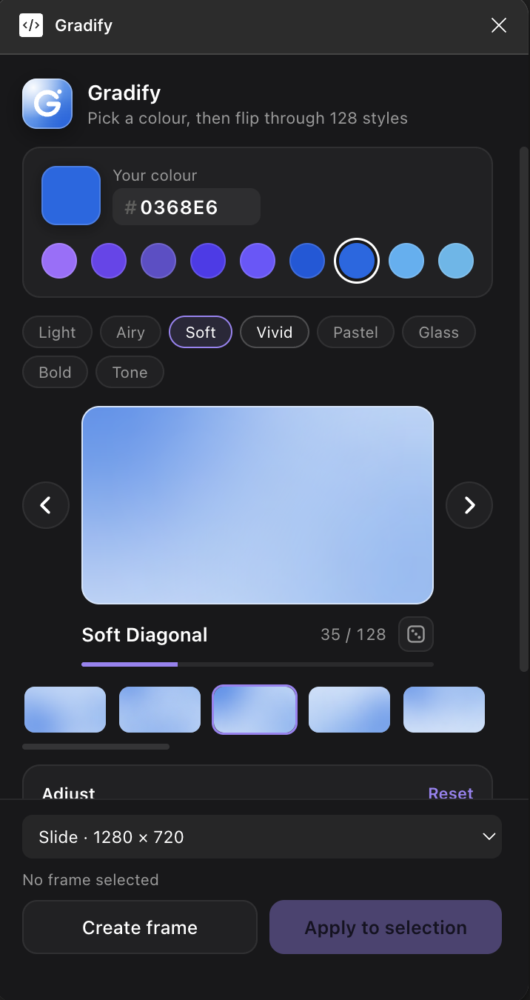
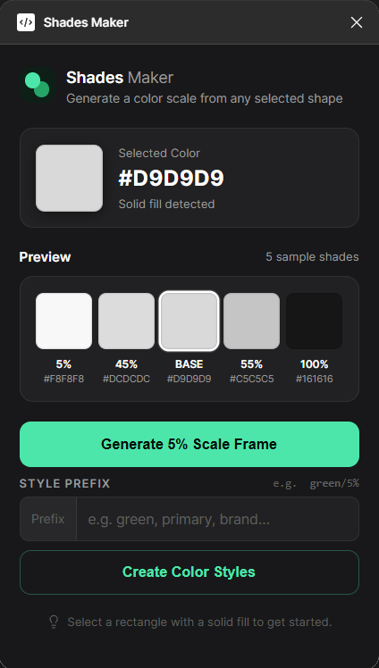
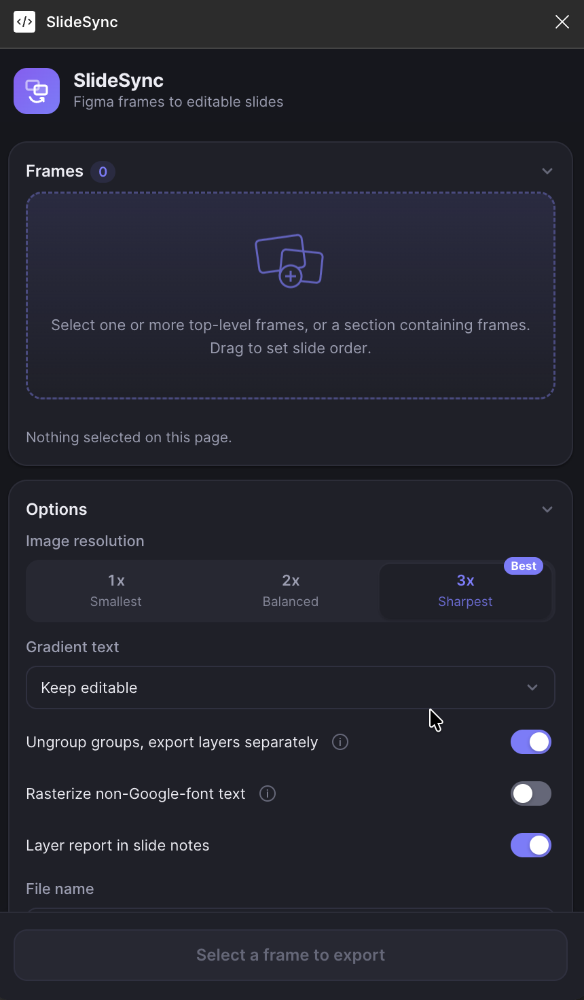
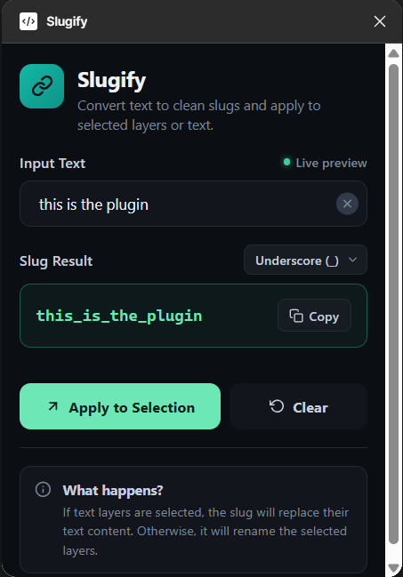
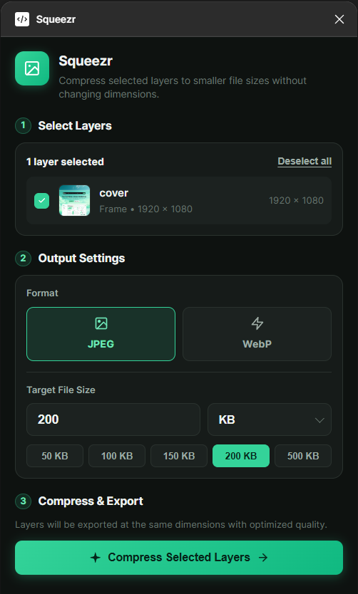
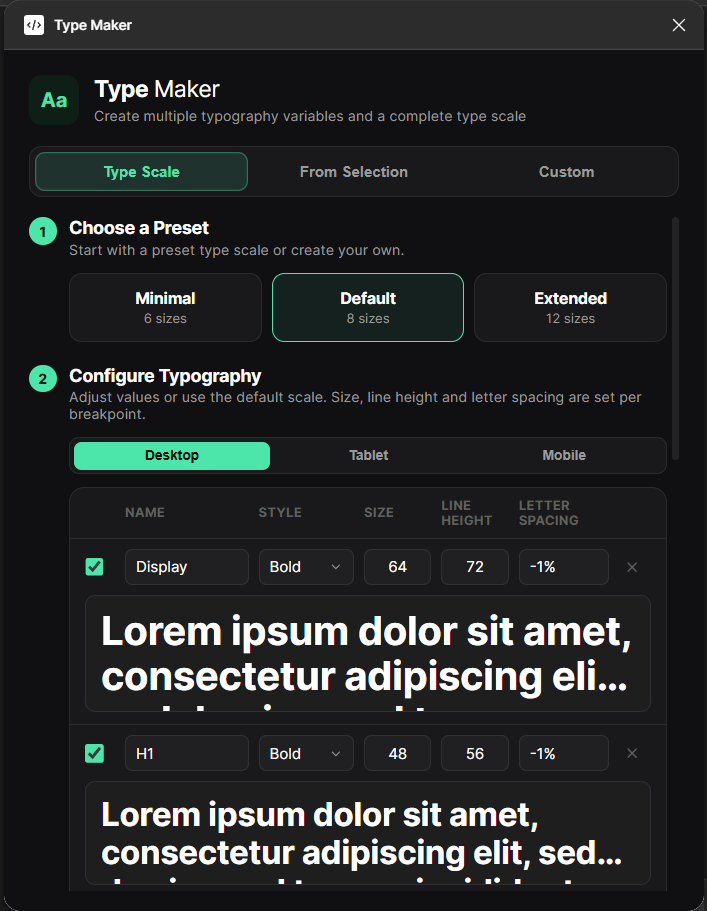
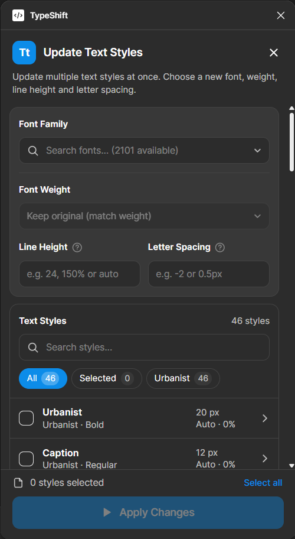

# Figma Plugins

A collection of Figma plugins built for design workflow.

## Plugins

| Plugin | Description |
|--------|-------------|
| **CardGlow** | Turns frames into glossy gradient cards (layered gradients, glows, sparkle, glass pills) from one colour, with 24 styles and sample content (React + TypeScript) |
| **Gradify** | Adds a soft blurred-blob gradient behind selected frames from one colour you pick, with 128 styles, moods, adjustments and ◀ ▶ browsing (React + TypeScript) |
| **ShadesMaker** | Generates a full color scale (5% steps) as an Auto Layout frame from a selected rectangle's fill color |
| **SlideSync** | Exports selected frames to one editable `.pptx` (one slide per frame), keeping text editable and layer names intact |
| **Slugify** | Converts selected text or input into a URL-friendly slug and applies it to a layer |
| **Squeezr** | Exports and compresses selected frames, groups, or shapes with thumbnail previews |
| **TypeMacker** | Creates typography scales and text styles from presets, custom values, or existing selected layers |
| **TypeShift** | Updates the font family, weight, line height and letter spacing of multiple local text styles at once |

## Previews

| Gradify | ShadesMaker | SlideSync |
|:-------:|:-----------:|:---------:|
|  |  |  |

| Slugify | Squeezr | TypeMacker |
|:-------:|:-------:|:----------:|
|  |  |  |

| TypeShift |
|:---------:|
|  |

## Usage

1. Open Figma and go to **Plugins -> Development -> Import plugin from manifest**
2. Select the `manifest.json` inside any plugin folder
3. Run the plugin from the Plugins menu

CardGlow, Gradify and SlideSync must be built first (`npm install && npm run build` inside the plugin folder); see [CardGlow/README.md](CardGlow/README.md), [Gradify/README.md](Gradify/README.md) and [SlideSync/README.md](SlideSync/README.md).
